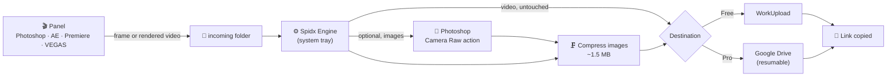

<div align="center">

<!-- Put your logo at docs/assets/logo.png and uncomment the line below -->
<!--  -->

# Spidx Uploader

**Render a frame or a whole video. Get a link. Never leave your timeline.**

A lightweight Windows helper plus native panels for **Photoshop**, **After Effects**, **Premiere Pro** and **VEGAS Pro**,
built to turn a single click into a polished, uploaded, shareable image or video.

<br>

[](https://github.com/vfxspidx/Spidx-Uploader/releases/latest)
[](#requirements)
[](#plugins)
[](#plugins)
[](#plugins)
[](#plugins)
[](#languages)

<br>

[**⬇ Download**](https://github.com/vfxspidx/Spidx-Uploader/releases/latest) &nbsp;·&nbsp;
[**Features**](#features) &nbsp;·&nbsp;
[**Installation**](#installation) &nbsp;·&nbsp;
[**How it works**](#how-it-works) &nbsp;·&nbsp;
[**Plans**](#plans) &nbsp;·&nbsp;
[**Troubleshooting**](#troubleshooting)

</div>

<br>

---

## Overview

**Spidx Uploader** removes the boring part of sharing your work. Pick a frame in After Effects or Premiere Pro, export from Photoshop, or render a video in Premiere Pro or VEGAS Pro, and the **Spidx Engine** running quietly in your system tray takes it from there: it optionally runs your Camera Raw look, compresses images, uploads the file and copies the link to your clipboard.

No exporting, no drag and drop, no browser tabs. Just a link.

<table>
<tr>
<td width="33%" valign="top">

### ⚡ One click
Send the current frame, or render and upload a whole video, straight from the panel inside your editing app.

</td>
<td width="33%" valign="top">

### 🎨 Auto-finished
Apply a Photoshop Camera Raw action to every frame before it goes out.

</td>
<td width="33%" valign="top">

### 🔗 Instant link
The shareable URL is copied for you as soon as the upload completes.

</td>
</tr>
</table>

---

## Features

| | Feature | Details |
|---|---|---|
| 🎬 | **Render & upload video** | In **Premiere Pro** and **VEGAS Pro**, pick your own render preset or template, let the host render (no extra compression) and the helper uploads the finished file. Clips from 1 second up to 30 minutes. |
| ☁️ | **Resumable uploads** | Big files go to Google Drive in chunks with live progress and speed, a **Cancel** button, and automatic resume after a network drop, restart or crash. |
| 🧩 | **Native panels** | Photoshop (UXP), After Effects (CEP), Premiere Pro (CEP) and a dockable VEGAS Pro plugin. Install one or all of them, they share the same engine. |
| 🛰️ | **Spidx Engine** | A tray helper that watches the `incoming` folder, queues files and reports live status back to every panel. Half-written videos are only picked up once they are complete. |
| 📦 | **Batch uploads** | Group up to **10 images** into a single batch with a custom folder name, then send it early with **Send now** or cancel it at any time. |
| 🗜️ | **Smart compression** | Images are compressed to around **1.5 MB** in a background worker thread, so the app stays responsive. Video is passed through untouched. |
| 🎞️ | **Camera Raw routing** | Frames from After Effects or Premiere can be dropped into your open Photoshop document and processed with your own Camera Raw action before upload. |
| 🔁 | **Two destinations** | **WorkUpload** (Free) or your own **Google Drive** with shared per-batch folders (Pro). WorkUpload recovers by itself if its browser tab is closed mid-upload. |
| ⌨️ | **Global shortcut** | `Ctrl+Alt+U` uploads the current frame while After Effects, Premiere Pro, Photoshop or VEGAS Pro is in front. Configurable in the Dashboard. |
| 🏆 | **Leaderboard tab** | Browse the SpidxTracker Fortnite leaderboard, search by name, filter by region and use **Copy Nick** in one click. |
| ✍️ | **Insert into graphics** | In After Effects, push a nick straight into a text layer. In Premiere, the **Properties** tab writes into a selected Graphics or MOGRT clip. |
| 🖥️ | **Dashboard** | Overview, History with thumbnails, Activity, Templates, searchable Settings, a Status page with health checks and a copyable report, light and dark themes. |
| 🌍 | **9 languages** | Dashboard, setup wizard, tray and the After Effects, Premiere Pro and VEGAS Pro panels. See [Languages](#languages). |
| 🔄 | **Built-in updater** | A small app-style window checks for new versions, downloads the installer with progress and can check and repair your installed panels. |
| 🔐 | **Licence tied to your computer** | Signed licence proofs bound to the machine they were issued to, valid up to 14 days offline. |
| 🧭 | **First-run wizard** | A guided setup that signs you in, picks your destination and installs the panels for you. |

---

## Plugins

| Plugin | Host | Technology | Highlights |
|---|---|---|---|
| **Photoshop panel** | Photoshop **2026** and newer | UXP (`.ccx`) | Upload from Photoshop, Camera Raw action runner |
| **After Effects panel** | After Effects **2025** and newer | CEP + ExtendScript | Current frame export, Uploader tab, Leaderboard tab, SPT templates, insert nick into text layer |
| **Premiere Pro panel** | Premiere Pro **2025** and newer | CEP + ExtendScript | Current frame export, **Render & upload**, Leaderboard tab, **Properties** tab for MOGRT text fields |
| **VEGAS Pro plugin** | VEGAS Pro | Application Extension (C#) | Dockable panel, **Render & upload** with your render templates, follows Windows display scaling |

All panels use the same dark, minimal interface and talk to the same engine, so you can have all of them installed at once.

> [!NOTE]
> UXP panels do not exist for After Effects, which is why the AE and Premiere plugins are CEP based.

---

## Installation

### Recommended: the installer

1. Make sure [Node.js](https://nodejs.org/en/download) is installed (the installer will remind you if it is not).
2. Download **`SpidxUploaderSetup.exe`** from the [latest release](https://github.com/vfxspidx/Spidx-Uploader/releases/latest).
3. Run it and follow the steps.
4. On first launch, the **setup wizard** opens in its own window. Sign in, choose your upload destination and let it install the panels for the Adobe apps and VEGAS Pro you use.
5. Open your editing app and find **Spidx Uploader** under **Window → Extensions** (Photoshop: **Plugins**, VEGAS Pro: **View → Extensions**).

Panels and plugins are published separately in the [`plugins` release](https://github.com/vfxspidx/Spidx-Uploader/releases/tag/plugins). The app tells you when a newer panel is available and the built-in updater can install or repair them.

### Manual (portable) install

Prefer to run it straight from a folder? Install [Node.js](https://nodejs.org/en/download) first, then download the source or the release archive and use:

| Step | File |
|---|---|
| Start the helper silently in the tray | `Spidx Uploader.vbs` |
| Add a desktop shortcut | `Install Desktop Shortcut.vbs` |
| Register the `spidx://` activation link | `Register Activate Link.bat` |
| Install the After Effects panel | `CEP-AE/Install AE Panel.bat` |
| Install the Premiere Pro panel | `CEP-PPRO/Install PPRO Panel.bat` |
| Install the VEGAS Pro plugin | `VEGAS-Plugin/Install VEGAS Plugin.bat` |
| Install the Photoshop panel | `UXP/com.spidx.workupload_PS.ccx` (needs Creative Cloud) |

### Premiere Pro: one-time preset for frames

Premiere cannot export a single frame from a script without a PNG export preset, so it needs one saved once per machine:

1. In Premiere, open **File → Export → Media**.
2. Set **Format** to **PNG** and click **Save Preset**.
3. Name it exactly **`pngframe`**.
4. Restart Premiere Pro.

The panel finds the preset automatically. More detail is in [`CEP-PPRO/PRESET-SETUP.txt`](CEP-PPRO/PRESET-SETUP.txt). Video renders do not need this preset, you choose any render preset you like in the panel.

---

## How it works



1. A panel saves a frame, or the host renders a video, into the shared `App/incoming` folder.
2. The engine picks it up. Images are grouped into a batch and, if enabled, go through your Camera Raw action. A video is its own upload and is picked up only once it has stopped growing.
3. Images are compressed, videos are sent as they are, to your chosen destination.
4. The link is copied to your clipboard, and every panel shows live progress.

Because every panel speaks the same simple file-based protocol, you can point all of them at the same `incoming` folder and use them together.

---

## Plans

| | **Free** | **Pro** |
|---|:---:|:---:|
| Photoshop, After Effects, Premiere Pro and VEGAS Pro panels | ✅ | ✅ |
| Batch uploads and compression | ✅ | ✅ |
| Leaderboard tab | ✅ | ✅ |
| WorkUpload destination | ✅ | ✅ |
| Video **Render & upload** | **15 per month** | **Unlimited** |
| Google Drive destination | – | ✅ |
| Camera Raw preset routing | – | ✅ |

- Renders are counted once per month across all apps, per Google account and per computer. Uploading stills is never counted. A video over the limit is moved to `incoming\rejected`, never deleted, and the panels warn you before you start.
- **Thumbnail Pack** (After Effects templates and presets, Premiere Pro MOGRT templates) is a separate add-on, delivered by the licence server to accounts that have it.
- Licenses are activated through Discord with the `spidx://` link and can be used on up to **2 devices**. A license can also be entered manually in the Dashboard.

---

## Languages

English, Polski, Deutsch, Français, Español, Português (BR), Italiano, Türkçe and Русский.

Change it in **Dashboard → Language**. **Auto** follows your Windows language. Texts without a translation, and texts that contain names or numbers, stay in English. The Photoshop panel is English only for now.

---

## Requirements

- **Windows 10 or 11**
- **Editing apps** (any combination):
  - **Photoshop 2026** or newer
  - **After Effects 2025** or newer
  - **Premiere Pro 2025** or newer
  - **VEGAS Pro** (the plugin is built for your installed version when you install it)
- **Adobe Creative Cloud desktop app** for installing the Photoshop panel
- **[Node.js](https://nodejs.org/en/download)** (LTS recommended). The Spidx Engine is a Node app, so it will not run without it. The installer checks for Node.js and offers to open the download page if it is missing
- A **Google account** for sign-in (and for Drive uploads on Pro)
- An internet connection

---

## Tray menu

Right-click the Spidx icon in the system tray for quick access to:

`Start / Stop / Restart helper` · `Change incoming folder` · `Open Dashboard` · `Open log` · `Copy last upload link` · `Reset Google sign-in` · `Start with Windows` · `Update available`

---

## Repository structure

```text
Spidx-Uploader
├── App/                 Spidx Engine, tray app, Dashboard, setup wizard, updater
├── CEP-AE/              After Effects panel
├── CEP-PPRO/            Premiere Pro panel
├── VEGAS-Plugin/        VEGAS Pro plugin (source and installer scripts)
├── UXP/                 Photoshop panel (.ccx)
├── Hotkey/              Global shortcut helper
├── Installer/           Inno Setup script for the Windows installer
├── docs/                Activation page and project site
├── .github/workflows/   Release automation
├── Spidx Uploader.vbs   Silent launcher
└── pngframe.epr         PNG export preset for Premiere Pro
```

---

## Troubleshooting

<details>
<summary><b>The panel does not appear in After Effects or Premiere Pro</b></summary>

<br>

Close the Adobe app, run the matching `Install … Panel.bat` again and reopen it. The installer enables the required debug mode for CEP panels.

</details>

<details>
<summary><b>Premiere says it cannot find <code>pngframe.epr</code></b></summary>

<br>

Create the preset once as described in [Premiere Pro: one-time preset](#premiere-pro-one-time-preset-for-frames), then restart Premiere Pro.

</details>

<details>
<summary><b>"Render &amp; upload" is greyed out</b></summary>

<br>

While **Files per upload** is set to 2 or 3, or a batch is being collected, video render is blocked, because a rendered video is always its own upload. Set it back to 1 or send the batch first. On the Free plan you may also have used your 15 renders for the month, the Dashboard shows the count.

</details>

<details>
<summary><b>The VEGAS Pro plugin does not show up</b></summary>

<br>

Close VEGAS Pro and run **Dashboard → Account → Plugins → VEGAS Pro plugin → Install / Update**. It finds your VEGAS, builds the plugin for it and copies it into the Application Extensions folder. Then open **View → Extensions → Spidx Uploader**.

</details>

<details>
<summary><b>The helper will not start or says Node.js was not found</b></summary>

<br>

Install [Node.js](https://nodejs.org/en/download) (LTS), then start the helper again with `Spidx Uploader.vbs`.

</details>

<details>
<summary><b>The panel says the helper is not running</b></summary>

<br>

Start it with `Spidx Uploader.vbs` or from the Start menu. If the tray shows an error, open the log from the tray menu. The Leaderboard also needs the helper running.

</details>

<details>
<summary><b>The Dashboard says something is wrong</b></summary>

<br>

Open **Dashboard → Status → Run self-test**. It checks Node.js, sign-in, licence, internet access, installed panels and the helper, and can create a diagnostics file for support with emails, tokens and user names removed.

</details>

<details>
<summary><b>The activation link opens a page and nothing happens</b></summary>

<br>

Run `Register Activate Link.bat` once. The app also re-registers the `spidx://` link every time it starts.

</details>

<details>
<summary><b>The Photoshop panel will not install</b></summary>

<br>

The Photoshop panel is installed through Adobe's own plugin installer, which ships with the Creative Cloud desktop app. Make sure Creative Cloud is installed and signed in, then try again from the Dashboard.

</details>

<details>
<summary><b>"Device limit reached"</b></summary>

<br>

A paid license works on up to 2 devices. This computer is currently running as Free. Remove an old device from your license in the Dashboard to free a slot.

</details>

---

## Support

Need help or want to report a bug?

- Open an [issue](https://github.com/vfxspidx/Spidx-Uploader/issues)
- Use the **Support** section in the Dashboard, and attach the diagnostics file from **Status**

---

<div align="center">

Made with care by [**vfxspidx**](https://github.com/vfxspidx)

<sub>Spidx Uploader is not affiliated with or endorsed by Adobe, MAGIX/VEGAS, Epic Games or Google. Adobe, Photoshop, After Effects and Premiere Pro are trademarks of Adobe Inc. VEGAS Pro is a trademark of its owner.</sub>

</div>
