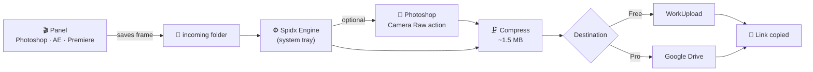

<div align="center">

<!-- Put your logo at docs/assets/logo.png and uncomment the line below -->
<!--  -->

# Spidx Uploader

**Render a frame. Get a link. Never leave your timeline.**

A lightweight Windows helper plus native panels for **Photoshop**, **After Effects** and **Premiere Pro**,
built to turn a single click into a polished, uploaded, shareable image.

<br>

[](https://github.com/vfxspidx/Spidx-Uploader/releases/latest)
[](#requirements)
[](#plugins)
[](#plugins)
[](#plugins)

<br>

[**⬇ Download**](https://github.com/vfxspidx/Spidx-Uploader/releases/latest) &nbsp;·&nbsp;
[**Features**](#features) &nbsp;·&nbsp;
[**Installation**](#installation) &nbsp;·&nbsp;
[**How it works**](#how-it-works) &nbsp;·&nbsp;
[**Troubleshooting**](#troubleshooting)

</div>

<br>

---

## Overview

**Spidx Uploader** removes the boring part of sharing your work. Pick a frame in After Effects or Premiere Pro, or export from Photoshop, and the **Spidx Engine** running quietly in your system tray takes it from there: it optionally runs your Camera Raw look, compresses the image, uploads it and copies the link to your clipboard.

No exporting, no drag and drop, no browser tabs. Just a link.

<table>
<tr>
<td width="33%" valign="top">

### ⚡ One click
Send the current frame straight from the panel inside your Adobe app.

</td>
<td width="33%" valign="top">

### 🎨 Auto-finished
Apply a Photoshop Camera Raw action to every frame before it goes out.

</td>
<td width="33%" valign="top">

### 🔗 Instant link
The shareable URL is copied for you as soon as the upload completes.

</td>
</tr>
</table>

---

## Features

| | Feature | Details |
|---|---|---|
| 🧩 | **Three native panels** | Photoshop (UXP), After Effects (CEP) and Premiere Pro (CEP). Install one or all of them, they share the same engine. |
| 🛰️ | **Spidx Engine** | A tray helper that watches the `incoming` folder, queues files and reports live status back to every panel. |
| 📦 | **Batch uploads** | Group up to **10 images** into a single batch with a custom folder name, then send it early with **Send now** or cancel it at any time. |
| 🗜️ | **Smart compression** | Images are automatically compressed to around **1.5 MB** in a background worker thread, so the app stays responsive. Video is passed through untouched. |
| 🎞️ | **Camera Raw routing** | Frames from After Effects or Premiere can be dropped into your open Photoshop document and processed with your own Camera Raw action before upload. |
| ☁️ | **Two destinations** | **WorkUpload** (Free) or your own **Google Drive** with shared per-batch folders (Pro). |
| 🏆 | **Leaderboard tab** | Browse the SpidxTracker Fortnite leaderboard, search by name, filter by region and use **Copy Nick** in one click. |
| ✍️ | **Insert into graphics** | In After Effects, push a nick straight into a text layer. In Premiere, the **Properties** tab writes into a selected Graphics or MOGRT clip. |
| 🖥️ | **Dashboard** | A full dashboard for destination, Camera Raw preset, license, devices, updates, plugins, backup and restore, and recent activity. |
| 🔁 | **Reliable by design** | Heartbeat status, automatic retries, throttled uploads, automatic cleanup of old files and a helper that never dies on a failed sign-in. |
| 🔔 | **Update notifications** | The tray tells you when a newer release is available on GitHub. |
| 🧭 | **First-run wizard** | A guided setup that signs you in, picks your destination and installs the panels for you. |

---

## Plugins

| Plugin | Host | Technology | Highlights |
|---|---|---|---|
| **Photoshop panel** | Photoshop **2026** and newer | UXP (`.ccx`) | Upload from Photoshop, Camera Raw action runner |
| **After Effects panel** | After Effects **2025** and newer | CEP + ExtendScript | Current frame export, Uploader tab, Leaderboard tab, insert nick into text layer |
| **Premiere Pro panel** | Premiere Pro **2025** and newer | CEP + ExtendScript | Current frame export, Uploader tab, Leaderboard tab, **Properties** tab for MOGRT text fields |

All panels use the same dark, minimal interface and talk to the same engine, so you can have all three installed at once.

> [!NOTE]
> UXP panels do not exist for After Effects, which is why the AE and Premiere plugins are CEP based.

---

## Installation

### Recommended: the installer

1. Make sure [Node.js](https://nodejs.org/en/download) is installed (the installer will remind you if it is not).
2. Download **`SpidxUploaderSetup.exe`** from the [latest release](https://github.com/vfxspidx/Spidx-Uploader/releases/latest).
3. Run it and follow the steps.
4. On first launch, the **setup wizard** opens in your browser. Sign in, choose your upload destination and let it install the panels for the Adobe apps you use.
5. Open your Adobe app and find **Spidx Uploader** under **Window → Extensions** (Photoshop: **Plugins**).

### Manual (portable) install

Prefer to run it straight from a folder? Install [Node.js](https://nodejs.org/en/download) first, then download the source or the release archive and use:

| Step | File |
|---|---|
| Start the helper silently in the tray | `Spidx Uploader.vbs` |
| Add a desktop shortcut | `Install Desktop Shortcut.vbs` |
| Register the `spidx://` activation link | `Register Activate Link.bat` |
| Install the After Effects panel | `CEP-AE/Install AE Panel.bat` |
| Install the Premiere Pro panel | `CEP-PPRO/Install PPRO Panel.bat` |
| Install the Photoshop panel | `UXP/com.spidx.workupload_PS.ccx` (needs Creative Cloud) |

### Premiere Pro: one-time preset

Premiere cannot export a single frame from a script without a PNG export preset, so it needs one saved once per machine:

1. In Premiere, open **File → Export → Media**.
2. Set **Format** to **PNG** and click **Save Preset**.
3. Name it exactly **`pngframe`**.
4. Restart Premiere Pro.

The panel finds the preset automatically in Media Encoder's presets folder. More detail is in [`CEP-PPRO/PRESET-SETUP.txt`](CEP-PPRO/PRESET-SETUP.txt).

---

## How it works



1. A panel saves the frame into the shared `App/incoming` folder.
2. The engine picks it up, groups it into a batch and, if enabled, runs your Camera Raw action in the open Photoshop document.
3. The image is compressed and uploaded to your chosen destination.
4. The link is copied to your clipboard, and every panel shows live progress.

Because every panel speaks the same simple file-based protocol, you can point all of them at the same `incoming` folder and use them together.

---

## Plans

| | **Free** | **Pro** |
|---|:---:|:---:|
| Photoshop, After Effects and Premiere panels | ✅ | ✅ |
| Batch uploads and compression | ✅ | ✅ |
| Leaderboard tab | ✅ | ✅ |
| WorkUpload destination | ✅ | ✅ |
| Google Drive destination | – | ✅ |
| Camera Raw preset routing | – | ✅ |

Licenses are activated through Discord with the `spidx://` link and can be used on up to **2 devices**. A license can also be entered manually in the Dashboard.

---

## Requirements

- **Windows 10 or 11**
- **Adobe apps** (any combination):
  - **Photoshop 2026** or newer
  - **After Effects 2025** or newer
  - **Premiere Pro 2025** or newer
- **Adobe Creative Cloud desktop app** for installing the Photoshop panel
- **[Node.js](https://nodejs.org/en/download)** (LTS recommended). The Spidx Engine is a Node app, so it will not run without it. The installer checks for Node.js and offers to open the download page if it is missing
- A **Google account** for sign-in (and for Drive uploads on Pro)
- An internet connection

---

## Tray menu

Right-click the Spidx icon in the system tray for quick access to:

`Start / Stop / Restart helper` · `Change incoming folder` · `Open Dashboard` · `Open log` · `Copy last upload link` · `Reset Google sign-in` · `Start with Windows` · `Update available`

---

## Repository structure

```text
Spidx-Uploader
├── App/                 Spidx Engine, tray app, dashboard, setup wizard
├── CEP-AE/              After Effects panel
├── CEP-PPRO/            Premiere Pro panel
├── UXP/                 Photoshop panel (.ccx)
├── Installer/           Inno Setup script for the Windows installer
├── docs/                Activation page and project site
├── .github/workflows/   Release automation
├── Spidx Uploader.vbs   Silent launcher
└── pngframe.epr         PNG export preset for Premiere Pro
```

---

## Troubleshooting

<details>
<summary><b>The panel does not appear in After Effects or Premiere Pro</b></summary>

<br>

Close the Adobe app, run the matching `Install … Panel.bat` again and reopen it. The installer enables the required debug mode for CEP panels.

</details>

<details>
<summary><b>Premiere says it cannot find <code>pngframe.epr</code></b></summary>

<br>

Create the preset once as described in [Premiere Pro: one-time preset](#premiere-pro-one-time-preset), then restart Premiere Pro.

</details>

<details>
<summary><b>The helper will not start or says Node.js was not found</b></summary>

<br>

Install [Node.js](https://nodejs.org/en/download) (LTS), then start the helper again with `Spidx Uploader.vbs`.

</details>

<details>
<summary><b>The panel says the helper is not running</b></summary>

<br>

Start it with `Spidx Uploader.vbs` or from the Start menu. If the tray shows an error, open the log from the tray menu.

</details>

<details>
<summary><b>The activation link opens a page and nothing happens</b></summary>

<br>

Run `Register Activate Link.bat` once. The app also re-registers the `spidx://` link every time it starts.

</details>

<details>
<summary><b>The Photoshop panel will not install</b></summary>

<br>

The Photoshop panel is installed through Adobe's own plugin installer, which ships with the Creative Cloud desktop app. Make sure Creative Cloud is installed and signed in, then try again from the Dashboard.

</details>

<details>
<summary><b>"Device limit reached"</b></summary>

<br>

A paid license works on up to 2 devices. This computer is currently running as Free. Remove an old device from your license to free a slot.

</details>

---

## Support

Need help or want to report a bug?

- Open an [issue](https://github.com/vfxspidx/Spidx-Uploader/issues)
- Use the **Support** section in the Dashboard

---

<div align="center">

Made with care by [**vfxspidx**](https://github.com/vfxspidx)

<sub>Spidx Uploader is not affiliated with or endorsed by Adobe, Epic Games or Google. Adobe, Photoshop, After Effects and Premiere Pro are trademarks of Adobe Inc.</sub>

</div>
